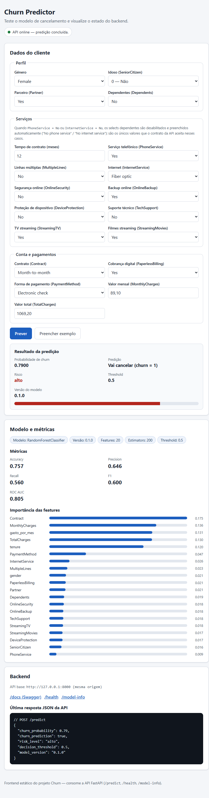

# prj_churn

Projeto-fio-condutor do curso de MLOps: previsão de **churn** (classificação
binária tabular). Este repositório é o *depois* da refatoração do Encontro 2 —
o script monolítico `train_churn.py` reorganizado na estrutura modular.

## Estrutura

```
prj_churn/
├─ src/churn/
│  ├─ config.py      # Settings (Pydantic) — caminhos, hiperparâmetros
│  ├─ schema.py      # contrato de dados (pandera) — Enc. 4
│  ├─ data.py        # carga + validação + limpeza
│  ├─ lineage.py     # data_md5 + git_commit (linhagem) — Enc. 6
│  ├─ experiments.py # grid de 9 runs rastreados — Enc. 6
│  ├─ registry.py    # melhor run -> gate -> churn@champion — Enc. 7/8
│  ├─ features.py    # transformações puras + encoder sem vazamento
│  ├─ model.py       # treino (entrypoint)
│  ├─ api.py         # API FastAPI de inferência (Enc. 12)
│  └─ evaluate.py    # métricas
├─ tests/            # pytest (dados, features, schema, api)
├─ web/              # frontend (HTML/CSS/JS) servido pela API em GET / — Enc. 12
├─ scripts/          # parquet_para_csv.py · make_v2.py · export_joblib.py (.pkl -> .joblib da API)
├─ data/             # dataset (versionado por DVC — Enc. 5)
├─ dvc.yaml          # pipeline reproduzível (dado + código -> modelo)
├─ Dockerfile        # imagem AUTOCONTIDA da API (uv + Python 3.14 + web/ + modelo)
├─ Dockerfile.train  # imagem do treino (uv) — Enc. 3
├─ compose.yml       # docker compose up (API) / --profile treino up
├─ .github/workflows/ci.yml  # testes + build Docker no GitHub Actions
├─ render.yaml       # deploy opcional na Render
└─ pyproject.toml / uv.lock   # deps travadas (uv)
```

## Como rodar (uv)

```bash
uv sync                          # cria o ambiente a partir do pyproject/uv.lock
uv run python -m churn.model     # treina e imprime as métricas
uv run pytest                    # roda os testes
```

Sem uv, para desenvolvimento rápido:

```bash
pip install -e ".[dev]"
python -m churn.model
pytest
```

## O que mudou em relação ao `train_churn.py`

| Script monolítico | Projeto modular |
|---|---|
| caminho hardcoded | `config.py` (Pydantic, sobrescrevível por env) |
| `fillna(2200)` mágico | `TotalCharges` em branco → `0.0` (cliente novo, `tenure=0`) |
| normalização por números mágicos | removida — Random Forest não precisa de escala |
| `LabelEncoder` no dataset inteiro (vazamento) | `CategoricalEncoder` com `fit` só no treino |
| sem `random_state` (acurácia instável) | semente fixa em split e modelo |
| só imprime `accuracy` | `evaluate` retorna accuracy, precision, recall, f1, roc_auc |
| tudo em nível de módulo | funções puras + orquestração em `train()` |

## Dados (DVC)

O `data/churn.csv` não está no Git: o Git guarda só o ponteiro `data/churn.csv.dvc`.

```bash
uv sync
dvc pull                 # baixa o dado do remote DVC
uv run dvc repro         # roda o pipeline (treino) só se algo mudou
```

Sem o remote, gere o CSV a partir do parquet: `uv run python scripts/parquet_para_csv.py churn.parquet`.

## API de inferência (FastAPI — Enc. 12)

A API empacota o pré-processamento que antes era responsabilidade de quem
consome o champion: reusa `add_derived_features` e o `CategoricalEncoder`
salvo junto com o modelo em `artifacts/churn_model.joblib`.

Rodar local:

```bash
uv sync
uv run uvicorn churn.api:app --port 8000
# docs interativas: http://localhost:8000/docs
```

Variáveis de ambiente (todas opcionais):

| Variável | Padrão | Uso |
|---|---|---|
| `CHURN_MODEL_PATH` | `artifacts/churn_model.joblib` | artefato modelo + encoder |
| `CHURN_DECISION_THRESHOLD` | `0.5` | corte da previsão binária; valor inválido (não numérico ou fora de [0, 1]) **não derruba o processo**: cai para `0.5` com aviso no log |
| `CHURN_CORS_ORIGINS` | `*` | origens separadas por vírgula |

Se o artefato não existir/corromper, `/health` responde `model_loaded=false`
e `/predict` devolve 503 com mensagem clara — o processo não cai.

### Artefatos do modelo (`pkl` × `joblib`)

Existem **dois** artefatos no repositório, com propósitos diferentes:

| Artefato | Quem gera | Onde vive | Quem consome |
|---|---|---|---|
| `artifacts/churn_model.pkl` | o treino (`churn.model`, etapa do `dvc.yaml`) | saída do DVC, local | pipeline versionado por DVC |
| `artifacts/churn_model.joblib` | `scripts/export_joblib.py` a partir do `.pkl` | **Git**, embutido na imagem Docker | a API (`CHURN_MODEL_PATH`) |

A API **só lê o `.joblib`** — o bundle é o mesmo (`{"model", "encoder"}`), o
formato é joblib comprimido (nível 9). Para usar um modelo recém-treinado:

```bash
uv run dvc repro                              # treino -> artifacts/churn_model.pkl
uv run python scripts/export_joblib.py        # .pkl -> artifacts/churn_model.joblib
# depois: rebuild da imagem (docker compose build api) OU monte um diretório
# que CONTENHA o churn_model.joblib exportado (ver seção Docker).
```

**Montar apenas o `.pkl` não substitui o modelo da API**: ela nunca lê
`churn_model.pkl`; sem o `.joblib` exportado no caminho, a imagem continua
servindo o modelo embutido.

O modelo de request usa `extra="forbid"`: **campos extras são rejeitados com
422** (ex.: enviar `customerID` no payload de `/predict` retorna erro de
validação, não é ignorado silenciosamente). `MonthlyCharges` e `TotalCharges`
também rejeitam `Infinity`/`NaN`/`-Infinity` (`allow_inf_nan=False`): o
request cai no 422 de validação e nenhum valor não finito chega a
`predict_proba` (que geraria 500).

### Endpoints

| Método | Rota | Descrição |
|---|---|---|
| `GET` | `/health` | `{"status": "ok", "model_loaded": true, "model_version", "timestamp"}` |
| `GET` | `/model-info` | tipo, 20 features, métricas de `artifacts/model_metrics.json`, importâncias |
| `POST` | `/predict` | 19 campos do cliente -> `churn_probability`, `churn_prediction`, `risk_level`, `decision_threshold`, `model_version` |
| `GET` | `/` | serve o frontend: `web/index.html` se `web/` existir (na imagem Docker ele está embutido); fora do container, sem `web/`, devolve JSON 404 |
| `GET` | `/docs`, `/openapi.json` | Swagger / contrato |

Exemplo de `POST /predict` (payload completo é obrigatório; fora dos valores
permitidos, campo faltando ou campo extra -> **422**):

```bash
curl -X POST http://localhost:8000/predict -H "Content-Type: application/json" \
  -d '{"gender":"Female","SeniorCitizen":0,"Partner":"Yes","Dependents":"No",
       "tenure":12,"PhoneService":"Yes","MultipleLines":"No",
       "InternetService":"Fiber optic","OnlineSecurity":"No","OnlineBackup":"Yes",
       "DeviceProtection":"No","TechSupport":"No","StreamingTV":"Yes",
       "StreamingMovies":"Yes","Contract":"Month-to-month","PaperlessBilling":"Yes",
       "PaymentMethod":"Electronic check","MonthlyCharges":89.1,"TotalCharges":1069.2}'
```

Saída real desta API com o payload acima (churn champion `0.1.0`,
threshold `0.5`):

```json
{
  "churn_probability": 0.79,
  "churn_prediction": true,
  "risk_level": "alto",
  "decision_threshold": 0.5,
  "model_version": "0.1.0"
}
```

`risk_level`: `baixo` se p < 0.35 · `medio` se 0.35 ≤ p < 0.60 · `alto` se
p ≥ 0.60. A probabilidade é arredondada **uma única vez** (4 casas) e
`churn_prediction`/`risk_level` são derivados exatamente do valor exibido em
`churn_probability` — as três saídas nunca divergem entre si.

### Testes da API

```bash
uv run pytest -q          # suíte completa (pipeline + API)
uv run pytest tests/test_api.py -q   # só a API (TestClient, artefato real)
```

## Frontend

O frontend está em `web/` e é servido pela API em `/`. Também pode ser publicado
no GitHub Pages — instruções em [`web/README.md`](web/README.md).



## Docker

Duas imagens, um repositório:

- **`Dockerfile`** — API de inferência **autocontida** (uv + Python 3.14): o
  frontend `web/` e o artefato do modelo (`artifacts/churn_model.joblib` +
  métricas) entram na imagem; `data/`, `mlruns/` e `.venv/` ficam de fora via
  `.dockerignore`. Roda como usuário não-root, expõe 8000, tem healthcheck
  próprio e o `CMD`/healthcheck usam `/app/.venv/bin/*` direto — nenhum `uv
  sync`/instalação de dependências de dev acontece em runtime.
- **`Dockerfile.train`** — pipeline de treino (a imagem antiga do Encontro 3).

### compose — perfis separados

```bash
docker compose up api                      # SO a API, em http://localhost:8000
docker compose --profile treino up treino  # SO o treino (volume em ./data)
docker compose config                      # valida a configuração sem subir nada
```

O serviço `treino` vive no profile `treino`: `docker compose up` nunca o roda
sem querer (e `--profile treino up treino` não sobe a API junto). O serviço
`api` **não monta volumes**: a imagem é autocontida e a API só lê
`artifacts/churn_model.joblib` — montar `./artifacts` com o `.pkl` do treino
não trocaria nada (ver "Artefatos do modelo" acima). Para servir um modelo
recém-treinado, exporte o joblib (`scripts/export_joblib.py`) e reconstrua a
imagem (`docker compose build api`); o compose traz um mount `:ro` comentado
como alternativa explícita para testar **sem rebuild** — que só funciona se o
`churn_model.joblib` exportado estiver em `./artifacts`.

### Rodar a imagem sem compose

`web/` está embutido na imagem, então **não é preciso montar nada** para ter a
UI (substitua `$(pwd)` conforme o shell). O `-v` abaixo só faz sentido para
testar **sem rebuild** um modelo recém-exportado — o diretório montado
precisa conter o `churn_model.joblib` (gere com `uv run python
scripts/export_joblib.py`); montar só o `.pkl` do treino **não** substitui o
modelo da API:

```powershell
# PowerShell
docker build -t churn-api:0.1 .
docker run -p 8000:8000 churn-api:0.1
docker run -p 8000:8000 -v "${PWD}/artifacts:/app/artifacts:ro" churn-api:0.1
```

```cmd
:: cmd.exe
docker run -p 8000:8000 -v "%CD%/artifacts:/app/artifacts:ro" churn-api:0.1
```

```bash
# bash/zsh
docker run -p 8000:8000 -v "$(pwd)/artifacts:/app/artifacts:ro" churn-api:0.1
```

O dado de treino nunca entra na imagem (Enc. 5): volume ou `dvc pull`.

## Deploy (opcional — Render)

`render.yaml` é um Blueprint com `runtime: docker`: build automático pelo
`Dockerfile` (imagem autocontida — API + frontend + modelo), health check em
`/health` e `PORT` respeitada pelo `CMD` do container. CORS liberado
(`CHURN_CORS_ORIGINS=*`) e as env vars da tabela acima.

## MLflow (Bloco 2 — Encontros 6, 7 e 8)

```bash
uv run python -m churn.model         # 1 treino rastreado (run "rf") + pickle p/ o DVC
uv run python -m churn.experiments   # grid 3x3 = 9 runs (~30 s, ~300 MB em mlruns/)
uv run python -m churn.registry      # melhor run -> gate roc_auc >= 0.80 -> churn@champion
uv run mlflow ui --backend-store-uri sqlite:///mlflow.db    # http://localhost:5000
```

- O backend (`sqlite:///mlflow.db`) é fixado em `config.py`, não em variável de ambiente.
  Para outro destino: `CHURN_MLFLOW_TRACKING_URI=...`.
- Cada run guarda params, métricas, as tags `data_md5` e `git_commit`, o modelo (com
  signature + input_example, cloudpickle) e o `encoder`. **Faça commit antes de treinar**,
  senão o `git_commit` registrado não corresponde ao código que rodou.
- O gate (`min_roc_auc`) e os nomes do modelo/alias também estão em `config.py`.
- `mlflow.db` e `mlruns/` estão no `.gitignore` (não vão para o GitHub).

Carregar o modelo de produção:

```python
from churn.registry import load_champion
model = load_champion()      # mlflow.pyfunc, URI models:/churn@champion
model.predict(x_encoded)     # atenção: espera as features JÁ codificadas (ver limitações)
```

**Limitação conhecida:** o modelo registrado é só o `RandomForest`. As features derivadas
e o `CategoricalEncoder` não estão dentro dele (o encoder é salvo como artefato do run).
Quem consumir o `champion` precisa aplicar o mesmo pré-processamento — a API (Enc. 12,
`src/churn/api.py`) resolve isso ao encapsular `add_derived_features` + encoder salvo.

## Próximos encontros

- **Bloco 3** — orquestração com Airflow.
- **Bloco 4** — API (FastAPI) com CI/CD. ✔ API + Docker + CI nesta unidade; frontend em `web/`.
