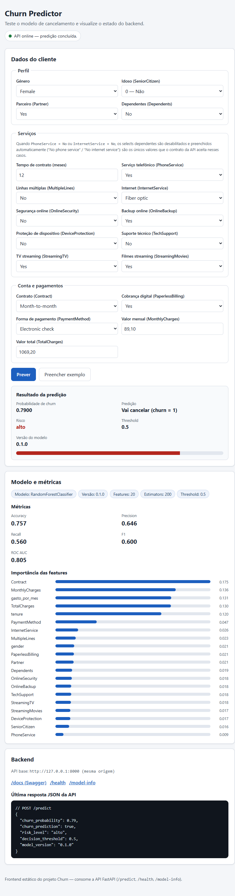
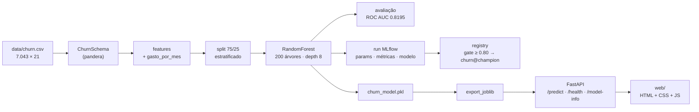

# Churn MLOps — previsão de cancelamento de clientes

[](https://github.com/Leo-bsb/churn-mlops-leonardo-borges/actions/workflows/ci.yml)
[](https://github.com/Leo-bsb/churn-mlops-leonardo-borges/actions/workflows/pages.yml)


Projeto-fio-condutor do curso de **MLOps**: prever quais clientes de uma
operadora de telecom vão cancelar (**churn**) e levar essa previsão até uma API
em produção — passando por contrato de dados, engenharia de features,
experimentos rastreados, registro de modelo, empacotamento, testes, CI e
container.

O que começou como um script monolítico (`train_churn.py`) virou um projeto
modular, reprodutível e testado: **62 testes**, **CI verde** construindo a
imagem Docker, **pipeline DVC** versionado e um **frontend estático** que conversa
com a API real.

| | |
|---|---|
| **Problema** | classificação binária tabular (churn = sim/não) |
| **Dados** | Telco Customer Churn — 7.043 clientes × 21 colunas |
| **Modelo servido** | `RandomForestClassifier` (200 árvores, profundidade 8, seed 42) |
| **ROC AUC (teste)** | **0.8195** · accuracy 0.7683 · F1 0.6151 |
| **Rastreamento** | MLflow (9 runs no grid) + Model Registry com alias `champion` |
| **Serving** | FastAPI (19 campos → probabilidade, classe e risco) + frontend estático |
| **Empacotamento** | Docker autocontido (API + UI + modelo), usuário não-root |
| **Qualidade** | pytest (62), contrato pandera, `uv lock --check`, CI com `dvc repro` e smoke test da imagem |

---

## Sumário

1. [Resultados](#1-resultados)
2. [Arquitetura](#2-arquitetura)
3. [Estrutura do repositório](#3-estrutura-do-repositório)
4. [Dados: fonte, contrato e versionamento](#4-dados-fonte-contrato-e-versionamento)
5. [Modelagem](#5-modelagem)
6. [Rastreamento e registro (MLflow)](#6-rastreamento-e-registro-mlflow)
7. [Artefatos do modelo](#7-artefatos-do-modelo)
8. [API de inferência](#8-api-de-inferência)
9. [Frontend](#9-frontend)
10. [Docker e deploy](#10-docker-e-deploy)
11. [Testes e CI](#11-testes-e-ci)
12. [Decisões de projeto (o “porquê”)](#12-decisões-de-projeto-o-porquê)
13. [Reproduzir do zero](#13-reproduzir-do-zero)
14. [Limitações e próximos passos](#14-limitações-e-próximos-passos)
15. [Solução de problemas](#15-solução-de-problemas)

---

## 1. Resultados

O número que importa é o desempenho **no conjunto de teste**, que o modelo nunca
viu no treino (25% dos dados, 1.761 clientes, split estratificado):

| Métrica | Valor | Leitura |
|---|---:|---|
| ROC AUC | **0.8195** | capacidade de ranquear quem tem mais risco (métrica de seleção) |
| Accuracy | 0.7683 | acerta 77% dos casos — mas veja o alerta abaixo |
| Precision | 0.6694 | de cada 100 clientes sinalizados, ~67 realmente cancelam |
| Recall | 0.5689 | de cada 100 cancelamentos reais, ~57 são capturados |
| F1 | 0.6151 | equilíbrio entre precision e recall |

Matriz de confusão no teste:

|  | Previsto: fica | Previsto: cancela |
|---|---:|---:|
| **Real: fica** (1.188) | 1.027 (TN) | 161 (FP) |
| **Real: cancela** (573) | 247 (FN) | 326 (TP) |

> **Por que não usar accuracy como métrica principal?** Porque a base é
> desbalanceada: 32,5% dos clientes cancelam. Um modelo que dissesse “ninguém
> cancela” teria **67,5% de accuracy** e seria inútil. ROC AUC mede o
> ordenamento do risco e não depende do threshold; por isso ela é o critério do
> *gate* de promoção (ver §6).

**O que mais pesa na decisão** (importância das features no modelo servido):

| Feature | Importância |
|---|---:|
| `Contract` (tipo de contrato) | 38,4% |
| `MonthlyCharges` | 10,9% |
| `tenure` (tempo de casa) | 10,4% |
| `TotalCharges` | 9,7% |
| `gasto_por_mes` (feature criada neste projeto) | 9,5% |
| `InternetService` | 5,7% |

A leitura de negócio é direta: **contrato mensal + mensalidade alta + pouco
tempo de casa** é o perfil de maior risco. A feature derivada `gasto_por_mes`
entrou em 5º lugar, à frente de serviços contratados — o que justifica tê-la
criado (§5).



<p align="center"><sub>Interface do Churn Predictor. Captura ilustrativa do layout: métricas e probabilidade mudam a cada treino (<code>model_metrics.json</code>).</sub></p>

---

## 2. Arquitetura



O fluxo tem seis etapas, cada uma com um dono claro no código:

| Etapa | Módulo | Responsabilidade |
|---|---|---|
| 1. Configuração | `config.py` | caminhos, hiperparâmetros e backend do MLflow (Pydantic) |
| 2. Dados | `data.py` + `schema.py` | carregar, limpar e **validar o contrato** antes de treinar |
| 3. Features | `features.py` | transformações puras + encoder que aprende só no treino |
| 4. Treino/avaliação | `model.py` + `evaluate.py` | treinar, medir, rastrear e gravar artefatos |
| 5. Governança | `lineage.py` + `experiments.py` + `registry.py` | linhagem, grid de runs e promoção do champion |
| 6. Serving | `api.py` + `web/` | inferência com o **mesmo** pré-processamento do treino |

**Princípio que guia a arquitetura:** nenhum módulo tem efeito colateral no
import. `api.py` só carrega o modelo no *lifespan* do FastAPI; `model.py` só
treina quando chamado. Isso é o que torna o projeto testável e o que permite
importar a API sem um artefato presente.

---

## 3. Estrutura do repositório

```text
churn-mlops-leonardo-borges/
├─ src/churn/
│  ├─ config.py        # Settings (Pydantic): caminhos, hiperparâmetros, MLflow
│  ├─ schema.py        # contrato de dados (pandera) — Encontro 4
│  ├─ data.py          # carga + validação estrutural + limpeza
│  ├─ features.py      # features derivadas + CategoricalEncoder (anti-leakage)
│  ├─ model.py         # treino de ponta a ponta + pkl + cartão do modelo
│  ├─ evaluate.py      # accuracy, precision, recall, F1, ROC AUC
│  ├─ lineage.py       # md5 do dado + commit do código
│  ├─ experiments.py   # grid 3×3 = 9 runs comparáveis — Encontro 6
│  ├─ registry.py      # melhor run → gate → churn@champion — Encontros 7/8
│  └─ api.py           # FastAPI: /health, /model-info, /predict e o frontend
├─ tests/              # 62 testes: dados, schema, features, modelo, MLflow, API
├─ web/                # frontend estático (HTML/CSS/JS, sem build)
├─ scripts/
│  ├─ export_joblib.py     # .pkl do treino → .joblib da API
│  ├─ make_v2.py           # cria a v2 do dado (+100 linhas válidas)
│  └─ parquet_para_csv.py  # regenera o CSV a partir do parquet do curso
├─ artifacts/
│  ├─ churn_model.joblib   # bundle modelo+encoder servido pela API (Git)
│  └─ model_metrics.json   # cartão do modelo exibido em /model-info (Git)
├─ data/churn.csv       # dataset (988 KB, versionado no Git — ver §4)
├─ dvc.yaml · dvc.lock  # pipeline reproduzível e seu último resultado
├─ .dvc/ · .dvcignore   # metadados do DVC (sem remote — ver §4)
├─ Dockerfile           # imagem AUTOCONTIDA da API (uv + Python 3.14)
├─ Dockerfile.train     # imagem do treino
├─ compose.yml          # `up` sobe a API; profile `treino` roda o pipeline
├─ .github/workflows/   # ci.yml (testes + DVC + Docker) e pages.yml (frontend)
├─ render.yaml          # deploy opcional na Render
├─ pyproject.toml       # dependências + configuração do pytest
├─ uv.lock              # versões travadas (uv)
└─ ROTEIRO.md           # passo a passo de reprodução, em ordem
```

---

## 4. Dados: fonte, contrato e versionamento

### 4.1 O dataset

Telco Customer Churn (dataset público de exemplo da IBM), 7.043 clientes e 21
colunas: dados demográficos, serviços contratados, contrato, cobrança e o alvo
`Churn` (`Yes`/`No`). Taxa de churn: **2.291 / 7.043 = 32,5%**.

O CSV versionado tem md5 `3a29edd8d69a0f5428433a8b0de2d0be`. Se você tiver o
`churn.parquet` original do curso, `scripts/parquet_para_csv.py` regenera o CSV
e confere se o resultado é byte a byte igual ao versionado.

Uma particularidade do dataset: **11 clientes têm `TotalCharges` em branco** e
todos eles têm `tenure = 0` (acabaram de entrar). O script original preenchia
com o número mágico `2200`; aqui esses casos viram `0.0`, que é o valor
verdadeiro (o cliente ainda não pagou nada). O teste
`test_coerce_total_charges_converte_branco_em_zero` documenta essa decisão.

### 4.2 Contrato de dados (`schema.py`)

O contrato é código: roda no treino **e** no CI, e falha **antes** do modelo.

| Regra | Por quê |
|---|---|
| `customerID` único | duplicata indica join errado ou CSV concatenado |
| `gender`, `Partner`, `Dependents`, `PaperlessBilling` ∈ {Yes, No} | evita categoria nova silenciosa |
| `SeniorCitizen` ∈ {0, 1} | garante o tipo que o encoder espera |
| `tenure` entre 0 e 72 | 72 meses é o teto real da base |
| `MonthlyCharges` entre 0 e 200 | pega erro de unidade (ex.: valor em centavos) |
| `TotalCharges` ≥ 0 | pega negativo/erro de parsing |
| `Contract` e `InternetService` com domínio fechado | categorias inéditas quebrariam o modelo em produção |

Decisões de implementação:

- **`lazy=True`**: reporta *todas* as falhas de uma vez (não para na primeira),
  o que encurta o ciclo de correção.
- **`strict=False`**: o schema exige as colunas que importam e tolera extras.
  Endurecer depois é fácil; começar rígido quebra o pipeline por motivo bobo.
- **Validação antes de remover `customerID`**: a unicidade do ID só pode ser
  checada enquanto a coluna existe.

`tests/test_schema.py` prova que o contrato pega dado ruim de propósito:
`tenure = 999`, `Contract = "Vitalício"`, ID duplicado e mensalidade negativa.

### 4.3 Por que o CSV está no Git (e não só no DVC)

Esta é uma decisão consciente, com trade-off explícito:

| | Este repositório | Alternativa canônica |
|---|---|---|
| Onde os bytes vivem | `data/churn.csv` no Git | cache do DVC + remote (S3/Drive/DagsHub) |
| `git clone` + treinar | funciona direto | exige `dvc pull` + credencial do remote |
| Tamanho no Git | ~1 MB | ~0 |
| Nova versão do dado | novo commit do CSV | novo ponteiro `.dvc` |

**Por quê:** o dataset tem menos de 1 MB, e o requisito mais importante aqui é
que qualquer pessoa (professor, colega, CI) consiga clonar e reproduzir sem
configurar armazenamento externo. O ganho do DVC (deduplicação e remote para
arquivos grandes) não paga esse custo nesse tamanho.

**O que o DVC continua fazendo:** o `dvc.yaml` descreve o pipeline
(`dado + código → modelo`), o `dvc.lock` registra os hashes exatos da execução
última e `dvc repro` evita retreinar quando nada mudou. É o DVC no papel que
importa para reprodutibilidade — só sem remote.

**Como migrar para o fluxo canônico** (quando o dado crescer):

```bash
dvc remote add -d storage s3://meu-bucket/churn     # ou outro remote
dvc add data/churn.csv                              # cria data/churn.csv.dvc
git rm --cached data/churn.csv                      # o CSV sai do Git
git add data/churn.csv.dvc data/.gitignore
dvc push
```

A linhagem já está preparada para os dois mundos: `lineage.data_md5` lê o
ponteiro `.dvc` se ele existir e, caso contrário, calcula o md5 do CSV em disco.
Sem esse fallback, todo run ficaria com `data_md5 = "unknown"` e a tag de
linhagem seria inútil.

### 4.4 Versionando dados (v1 → v2)

`scripts/make_v2.py` cria 100 linhas novas **válidas** (reamostragem de clientes
existentes com `customerID` inédito e semente fixa), simulando uma atualização
da base. Como o CSV está no Git, a troca de versão é um `git checkout`:

```bash
uv run python scripts/make_v2.py     # 7.043 → 7.143 clientes
uv run dvc repro                     # retreina e atualiza dvc.lock
git add data/churn.csv dvc.lock
git commit -m "dados v2: +100 clientes"

# voltar para a v1
git checkout HEAD~1 -- data/churn.csv dvc.lock
uv run dvc repro
```

---

## 5. Modelagem

### 5.1 Features

Além das 19 colunas originais (sem `customerID`), o projeto cria **uma** feature:

```python
gasto_por_mes = TotalCharges / (tenure + 1)
```

- **Por que `+1`:** `tenure = 0` existe (clientes novos) e dividiria por zero.
  O `+1` é a suavização mais simples e mantém a escala interpretável.
- **Por que é seguro antes do split:** é uma transformação *row-wise* — cada
  linha depende só dela mesma. Não olha a distribuição do dataset, então não há
  vazamento.
- **Por que valeu a pena:** virou a 5ª feature mais importante, à frente de
  serviços como `OnlineSecurity` e `TechSupport`.

**Não há normalização/padronização.** Random Forest é invariante à escala das
features (cada split compara valores dentro de uma variável), então o
`StandardScaler` do script original era trabalho sem retorno. Menos código,
menos estado para versionar junto com o modelo.

### 5.2 Split e encoding sem vazamento

```python
split 75/25, random_state=42, stratify=y
```

- **Estratificado** para manter a proporção de churn (~32,5%) nos dois lados.
- **Seed fixa** para o resultado ser reprodutível: duas execuções produzem
  exatamente o mesmo `.pkl` (verificado byte a byte durante o desenvolvimento).
- **O `CategoricalEncoder` aprende as categorias só no treino** e é aplicado no
  teste. O script original usava `LabelEncoder` no dataset inteiro, o que é
  vazamento: o teste influenciava o mapeamento das categorias.
- Categorias desconhecidas no *transform* viram `-1`
  (`handle_unknown="use_encoded_value"`) em vez de quebrar — é o mesmo
  comportamento que a API usa hoje em produção.

Por que `OrdinalEncoder` e não *one-hot*: árvores conseguem lidar com códigos
ordinais e a dimensão fica em 20 features (one-hot passaria de 40). O ganho de
um encoding mais sofisticado não se justifica para um baseline.

### 5.3 Modelo

`RandomForestClassifier(n_estimators=200, max_depth=8, random_state=42)`.

- **Por que Random Forest:** baseline forte para tabular, não-linear, robusto a
  outliers, pouco sensível a escala e com poucos hiperparâmetros. É o ponto de
  partida honesto antes de justificar boosting ou rede neural.
- **Por que `max_depth=8`:** o grid mostrou que limitar a profundidade
  **regulariza** e melhora o teste (0.8053 → 0.8195). Sem limite, as árvores
  memorizam o treino.
- **Por que 200 árvores:** de 200 para 500 o ganho é 0.8195 → 0.8192 (ruído),
  com 2,5× mais tempo de treino e um `.pkl` maior. 200 é o melhor custo/benefício.

### 5.4 Métricas e o grid de experimentos

`evaluate.py` devolve cinco métricas — nunca só accuracy:

| Métrica | Para que serve aqui |
|---|---|
| ROC AUC | **seleção de modelo e gate** (independe do threshold) |
| Precision | custo de uma campanha de retenção desperdiçada (falso positivo) |
| Recall | quantos cancelamentos reais são capturados (falso negativo) |
| F1 | resumo do equilíbrio precision/recall |
| Accuracy | comunicação executiva, com a ressalva do desbalanceamento |

O grid (`python -m churn.experiments`) roda 9 combinações — 3 valores de
`n_estimators` × 3 de `max_depth` — **com o mesmo split e o mesmo encoder**,
para a comparação ser justa. Resultado real da execução registrada:

| `n_estimators` | `max_depth` | ROC AUC | Accuracy |
|---:|---:|---:|---:|
| 100 | None | 0.8036 | 0.7592 |
| 100 | **8** | 0.8182 | 0.7655 |
| 100 | 16 | 0.8028 | 0.7530 |
| 200 | None | 0.8053 | 0.7570 |
| **200** | **8** | **0.8195** | **0.7683** |
| 200 | 16 | 0.8047 | 0.7507 |
| 500 | None | 0.8066 | 0.7598 |
| 500 | 8 | 0.8192 | 0.7723 |
| 500 | 16 | 0.8068 | 0.7604 |

Leituras que o grid permite fazer:

1. **Profundidade importa mais que quantidade de árvores.** Todas as linhas com
   `depth=8` ficam acima de 0.818; nenhuma com `depth=None` chega a 0.807.
2. **A partir de 200 árvores, mais árvores não ajudam** (0.8195 → 0.8192).
3. Por isso `max_depth=8` e `n_estimators=200` são o default em `config.py`:
   **o modelo que a API serve é o mesmo que venceu o grid** — não existe a
   incoerência de servir um modelo pior do que o promovido no registry.

---

## 6. Rastreamento e registro (MLflow)

### 6.1 Cada treino é um run

`python -m churn.model` cria um run no experimento `churn` com:

- **params:** `n_estimators`, `max_depth`, `random_state`, `test_size`
  (apenas o que influencia o modelo — caminhos e URI de tracking são ambiente,
  não hiperparâmetro);
- **métricas:** as cinco de `evaluate.py`;
- **tags de linhagem:** `data_md5` (qual dado) e `git_commit` (qual código);
- **modelo:** `mlflow.sklearn.log_model` com `signature` + `input_example` e
  serialização `cloudpickle`;
- **encoder:** artefato separado do run (`encoder/encoder.pkl`), porque ele
  faz parte do contrato de inferência.

O backend é fixado **no código** (`sqlite:///mlflow.db` em `config.py`), não em
variável de ambiente. Isso evita o clássico “os runs sumiram”: cada terminal
apontava para um backend diferente. Para usar outro destino:
`CHURN_MLFLOW_TRACKING_URI=...`.

> ⚠️ Faça commit **antes** de treinar. O run grava o hash do commit atual; se
> houver alteração não commitada, o `git_commit` registrado não corresponde ao
> código que rodou.

Interface:

```bash
uv run mlflow ui --backend-store-uri sqlite:///mlflow.db   # http://localhost:5000
```

### 6.2 Promoção com gate (`registry.py`)

```text
melhor run por roc_auc  →  gate: roc_auc >= 0.80  →  alias champion
```

- **Gate:** um modelo só vira `champion` se superar `min_roc_auc` (0.80,
  configurável em `config.py`). Abaixo disso o script falha com mensagem clara.
- **Alias, não stage:** `churn@champion` é um alias mutável; consumidores pedem
  `models:/churn@champion` e sempre recebem a versão atual — sem editar código a
  cada promoção.
- **Idempotente:** se o melhor run já é o champion, nenhuma versão nova é
  criada (pode rodar em CI sem inflar o registry).
- **`search_runs(experiment_names=[...])`:** o primeiro argumento posicional
  seria *ids* de experimento, não nomes — erro comum que devolve zero runs.

Uso:

```bash
uv run python -m churn.experiments   # 9 runs
uv run python -m churn.registry      # -> churn v1 @champion (rf-n200-d8, roc_auc 0.8195)
```

**Limitação conhecida (e como o projeto resolve):** o modelo registrado é só o
`RandomForest`. As features derivadas e o `CategoricalEncoder` ficam como
artefato do run. Quem consumir o `champion` pelo MLflow precisa repetir o
pré-processamento — a API resolve isso encapsulando `add_derived_features` +
encoder salvo no bundle. É por isso que o caminho de serving é o `.joblib`, e
não o `models:/`.

---

## 7. Artefatos do modelo

Existem **dois** artefatos com propósitos diferentes — e confundir os dois é a
principal fonte de erro operacional deste projeto:

| Artefato | Gerado por | Onde vive | Quem consome |
|---|---|---|---|
| `artifacts/churn_model.pkl` | `python -m churn.model` / `dvc repro` | saída do DVC (`.gitignore`) | pipeline versionado |
| `artifacts/churn_model.joblib` | `scripts/export_joblib.py` | **Git** + imagem Docker | a API (`CHURN_MODEL_PATH`) |
| `artifacts/model_metrics.json` | `python -m churn.model` | **Git** + imagem Docker | `/model-info` e a UI |

- **Mesmo conteúdo, formatos diferentes:** os dois primeiros são o mesmo bundle
  `{"model", "encoder"}`; o `.joblib` é comprimido (nível 9) e por isso vai de
  ~5,3 MiB para ~1,3 MiB — viável versionar no Git.
- **Por que não versionar o `.pkl`:** 5+ MiB por treino no histórico do Git, e
  ele é reproduzível a partir de dado + código (`dvc repro`).
- **Por que a API não lê o `.pkl`:** a imagem é autocontida e leve; o formato
  comprimido é o contrato do runtime. Montar só o `.pkl` **não** troca o modelo
  da API.

O **cartão do modelo** (`model_metrics.json`) não existia como saída do treino
antes: era um arquivo solto, e qualquer retreino deixaria a UI mostrando
métricas velhas. Agora `churn.model` grava o cartão a cada treino, com métricas,
importâncias, versões de biblioteca, `trained_at`, `data_md5` e `git_commit`.
Ele não é `outs` do DVC porque carrega `trained_at` (o hash mudaria a cada run) e
porque a imagem Docker o consome direto do Git.

Fluxo para colocar um modelo recém-treinado no ar:

```bash
uv run dvc repro                              # gera artifacts/churn_model.pkl
uv run python scripts/export_joblib.py        # .pkl -> .joblib (comprimido)
docker compose build api                      # rebuild com o novo artefato
```

---

## 8. API de inferência

Rodar local:

```bash
uv run uvicorn churn.api:app --port 8000
# UI:      http://localhost:8000/
# Swagger: http://localhost:8000/docs
```

### 8.1 Endpoints

| Método | Rota | Descrição |
|---|---|---|
| `GET` | `/health` | `status`, `model_loaded`, `model_version`, `timestamp` |
| `GET` | `/model-info` | tipo, features, hiperparâmetros, métricas, linhagem e importâncias |
| `POST` | `/predict` | 19 campos do cliente → probabilidade, classe, risco e threshold |
| `GET` | `/` | frontend (`web/index.html`) |
| `GET` | `/docs`, `/openapi.json` | Swagger e contrato OpenAPI |

### 8.2 Contrato de entrada

O request model usa `extra="forbid"`: **campo extra é 422**, não é ignorado
silenciosamente (ex.: mandar `customerID`). Todos os 19 campos são obrigatórios
e os valores são fechados por `Literal` — `Contract = "Vitalício"` retorna 422
em vez de virar `-1` no encoder.

`MonthlyCharges` e `TotalCharges` usam `allow_inf_nan=False`: `Infinity`, `NaN`
e `1e400` são rejeitados na validação. Sem isso, o valor chegaria a
`predict_proba` e geraria **500**; com isso, o cliente recebe 422 e o processo
continua saudável.

### 8.3 Resposta e regras de decisão

```bash
curl -X POST http://localhost:8000/predict -H "Content-Type: application/json" -d '{
  "gender":"Female","SeniorCitizen":0,"Partner":"Yes","Dependents":"No",
  "tenure":12,"PhoneService":"Yes","MultipleLines":"No",
  "InternetService":"Fiber optic","OnlineSecurity":"No","OnlineBackup":"Yes",
  "DeviceProtection":"No","TechSupport":"No","StreamingTV":"Yes",
  "StreamingMovies":"Yes","Contract":"Month-to-month","PaperlessBilling":"Yes",
  "PaymentMethod":"Electronic check","MonthlyCharges":89.1,"TotalCharges":1069.2
}'
```

Resposta real com o modelo servido:

```json
{
  "churn_probability": 0.7255,
  "churn_prediction": true,
  "risk_level": "alto",
  "decision_threshold": 0.5,
  "model_version": "0.1.0"
}
```

| Campo | Regra |
|---|---|
| `churn_probability` | `predict_proba` da classe 1, arredondada **uma única vez** (4 casas) |
| `churn_prediction` | `probabilidade >= CHURN_DECISION_THRESHOLD` (padrão 0.5) |
| `risk_level` | `baixo` se p < 0.35 · `medio` se 0.35 ≤ p < 0.60 · `alto` se p ≥ 0.60 |
| `decision_threshold` | o corte efetivo, para o cliente saber com o que comparar |

**Detalhe que parece pequeno e não é:** `churn_prediction` e `risk_level` são
derivados do valor **já arredondado** que aparece em `churn_probability`. Assim
as três saídas nunca divergem entre si (ex.: mostrar `0.3500` como “baixo”
porque o valor cru era `0.34996`). Há testes parametrizados nas fronteiras
0.35 / 0.60 / 0.50.

`risk_level` é decisão de produto, não do modelo: o corte binário continua
sendo o threshold; o nível traduz a probabilidade em uma leitura de negócio.

### 8.4 Degradação graciosa

- Se o artefato não existir ou estiver corrompido, **o processo não cai**:
  `/health` responde 200 com `model_loaded: false` e `/predict` responde **503**
  com mensagem explicando o caminho do artefato.
- `/health` responde 200 mesmo sem modelo de propósito: o healthcheck da Render
  usa essa rota e derrubaria o serviço em loop se ela retornasse erro.
- `/model-info` responde 503 sem modelo; com modelo e cartão ausente, devolve
  `metrics: {}` em vez de quebrar.

### 8.5 Variáveis de ambiente

| Variável | Padrão | Uso |
|---|---|---|
| `CHURN_MODEL_PATH` | `artifacts/churn_model.joblib` | bundle modelo + encoder |
| `CHURN_METRICS_PATH` | `artifacts/model_metrics.json` | cartão do modelo |
| `CHURN_WEB_DIR` | `web` | pasta do frontend servido em `/` |
| `CHURN_DECISION_THRESHOLD` | `0.5` | corte binário |
| `CHURN_CORS_ORIGINS` | `*` | origens separadas por vírgula |
| `PORT` | `8000` | porta do uvicorn (injetada pela Render) |

Um `CHURN_DECISION_THRESHOLD` inválido (texto, `nan` ou fora de `[0, 1]`) **não
derruba o import**: cai para `0.5` com aviso no log. Configuração errada deve
ser visível, não fatal.

---

## 9. Frontend

`web/` é HTML + CSS + JS puros: **sem CDN, sem npm, sem build**. Três razões:
o escopo não justifica um framework; a página abre em qualquer lugar (inclusive
no GitHub Pages); e não existe cadeia de suprimentos para auditar.

O que a interface faz:

- formulário com os 19 campos do contrato e validação no cliente (números
  vazios ou fora da faixa geram mensagem e foco no primeiro campo inválido —
  nada vira `0` silenciosamente);
- selects dependentes: `PhoneService = No` fixa `MultipleLines` em
  “No phone service”; `InternetService = No` fixa os add-ons em “No internet
  service” (são os únicos valores que o contrato aceita nesses casos);
- painel com `/health` e `/model-info`: métricas, importâncias e linhagem;
- timeout de 15 s com `AbortController` e cancelamento de predição antiga ao
  resetar o formulário (sem “resultado fantasma”);
- resposta HTTP 200 que não seja JSON é tratada como erro, nunca como predição.

**Mesma origem por padrão:** o FastAPI serve `web/` em `/`, então
`window.CHURN_API_BASE = ""` funciona. No GitHub Pages, o workflow injeta a URL
do backend a partir da repository variable `CHURN_API_BASE`; sem ela, a página
mostra um aviso claro em vez de falhar em silêncio. Instruções detalhadas em
[`web/README.md`](web/README.md).

---

## 10. Docker e deploy

### 10.1 A imagem da API é autocontida

`Dockerfile` (uv + Python 3.14) coloca na imagem: código, `web/`, o
`.joblib` e o cartão de métricas. `data/`, `.venv/`, `mlruns/` e `.dvc/` ficam
de fora via `.dockerignore`.

Decisões:

- **deps antes do código:** mudar um `.py` não reinstala o mundo (cache de layer).
- **`uv sync --frozen --no-dev`:** versões do `uv.lock`, sem ferramentas de
  desenvolvimento no runtime.
- **usuário não-root** (`appuser`) com `chown` de `/app`.
- **`CMD` e healthcheck usam `/app/.venv/bin/*` direto:** nenhum `uv sync` em
  runtime; o processo é o `uvicorn`.
- **`PORT` respeitada:** a Render injeta a porta; localmente o default é 8000.
- **healthcheck próprio** em `/health` (intervalo 30 s, 3 retries).

### 10.2 Compose com perfis

```bash
docker compose up --build                    # SÓ a API em http://localhost:8000
docker compose --profile treino up treino    # SÓ o treino (dado via volume)
docker compose config                        # valida sem subir nada
```

O serviço `treino` está atrás do profile `treino`, então `docker compose up`
nunca treina sem querer. Ele monta `./data`, `./artifacts`, `./src` e
`./mlflow`: os runs do MLflow ficam no host
(`sqlite:////app/mlflow/mlflow.db`), em vez de desaparecerem com o container.

O serviço `api` **não monta volumes**: montar `./artifacts` com o `.pkl` do
treino não trocaria nada (a API só lê o `.joblib`). O compose traz um mount
comentado como alternativa explícita para testar **sem rebuild** — que só
funciona se o `.joblib` exportado estiver em `./artifacts`.

### 10.3 Deploy (Render, opcional)

`render.yaml` é um Blueprint com `runtime: docker`: build pelo `Dockerfile`,
health check em `/health`, `CHURN_CORS_ORIGINS=*` e `PORT` injetada. Para o
frontend no Pages apontar para lá, configure a variable `CHURN_API_BASE` com a
URL pública do serviço.

---

## 11. Testes e CI

```bash
uv run pytest -q                 # 62 passed
uv run pytest tests/test_api.py -q
```

| Arquivo | O que garante |
|---|---|
| `test_schema.py` | contrato pega `tenure=999`, contrato inédito, ID duplicado, mensalidade negativa |
| `test_data.py` | limpeza de `TotalCharges`, pureza das funções, dataset real inteiro válido |
| `test_features.py` | feature derivada, mapeamento do alvo e categoria desconhecida → `-1` |
| `test_model.py` | `train` grava `.pkl` **e** cartão, métricas/importâncias coerentes, linhagem preenchida |
| `test_mlflow_pipeline.py` | run registra params/métricas/tags/modelo; gate; champion idempotente; `pyfunc` carrega |
| `test_lineage.py` | md5 pelo ponteiro DVC, fallback para o CSV e tolerância a ponteiro corrompido |
| `test_api.py` | `/health`, `/model-info`, `/predict`, 422 (campo extra/ausente/valor inválido/inf/NaN), 503 sem artefato, fronteiras de risco e reuso do pipeline |

**CI (`.github/workflows/ci.yml`)** — dois jobs:

1. **`testes`**: `uv lock --check` → `uv sync --frozen` → `pytest` → import da
   API → **`dvc repro`** no dataset real → confere o cartão (`roc_auc > 0.80` e
   `data_md5` preenchido).
2. **`build-docker`** (só se os testes passarem): valida o `compose.yml`,
   garante os artefatos no contexto, faz o build e sobe o container para testar
   `/health` (`model_loaded: true`), `/` (HTML) e `/predict` (JSON válido).

O build de Docker acontece no CI de propósito: era o único passo que a máquina
de desenvolvimento não conseguia validar.

---

## 12. Decisões de projeto (o “porquê”)

Resumo das decisões e das alternativas descartadas:

| Decisão | Por quê | Alternativa descartada |
|---|---|---|
| Módulos pequenos em `src/churn` | testar e reusar sem efeito colateral | script monolítico |
| `Settings` (Pydantic) | uma fonte de verdade, sobrescrita por `CHURN_*`/`.env` | caminhos hardcoded |
| Contrato pandera | falha cedo e barulhenta, vira teste no CI | confiar no CSV |
| `TotalCharges` branco → `0.0` | é o valor real de cliente com `tenure=0` | `fillna(2200)` mágico |
| `gasto_por_mes` com `+1` | evita divisão por zero e é row-wise | `TotalCharges/tenure` (quebra em 0) |
| Sem normalização | RF é invariante à escala | `StandardScaler` sem ganho |
| Encoder `fit` só no treino | elimina vazamento | `LabelEncoder` no dataset inteiro |
| Split estratificado + seed | proporção do alvo e resultado reprodutível | split aleatório sem seed |
| RF 200/depth 8 | melhor custo/benefício e melhor AUC no grid | boosting (complexidade sem ganho claro) |
| ROC AUC como métrica de seleção | base desbalanceada; independe do threshold | accuracy |
| Threshold 0.5 configurável | permite calibrar custo de FP × FN | threshold fixo no código |
| Arredondar uma vez | respostas nunca divergem entre si | arredondar em cada campo |
| MLflow com URI fixa | runs não “somem” entre terminais | `export MLFLOW_TRACKING_URI` |
| Gate `roc_auc >= 0.80` | impede promoção de modelo ruim | promover sempre o “melhor” |
| Alias `champion` | consumidor sempre pega a versão atual | editar código a cada versão |
| `.pkl` no DVC + `.joblib` no Git | artefato reproduzível × imagem leve | versionar 5 MiB por treino |
| Cartão do modelo gerado no treino | métricas da UI nunca ficam órfãs | JSON mantido à mão |
| CSV no Git | clone reproduz sem remote/credencial | DVC-only (exige `dvc pull`) |
| Frontend sem framework | zero build, zero dependência, abre em qualquer lugar | React/Vue para 1 formulário |
| Imagem autocontida + não-root | deploy de um artefato só, superfície menor | montar volumes em produção |
| 503 em vez de crash | o serviço continua no ar e o erro é explícito | deixar o import falhar |

Três princípios atravessam o projeto:

1. **Falhe cedo, mas não derrube o serviço.** Dado inválido para o pipeline;
   artefato ausente degrada a API com 503, nunca com processo morto.
2. **Uma única fonte de verdade.** Hiperparâmetros em `config.py`; o
   pré-processamento é importado (`add_derived_features` + encoder), nunca
   reimplementado na API.
3. **Reprodutibilidade é um teste, não uma promessa.** Seed fixa, `uv.lock`,
   `dvc.lock` e CI rodando o pipeline real a cada push.

---

## 13. Reproduzir do zero

Pré-requisitos: Git, [uv](https://docs.astral.sh/uv/) e, para Docker,
Docker Desktop/Engine. Python é baixado pelo `uv` conforme o `uv.lock`
(3.11+; CI e imagens usam 3.14).

```bash
git clone https://github.com/Leo-bsb/churn-mlops-leonardo-borges.git
cd churn-mlops-leonardo-borges

uv sync                        # cria .venv e instala do uv.lock
uv run pytest -q               # 62 passed
uv run dvc repro               # treina (dado + código -> artifacts/)
uv run python -m churn.model   # alternativa direta, imprime as métricas

uv run uvicorn churn.api:app --port 8000
# http://localhost:8000/  ·  /docs
```

Sem `uv` (desenvolvimento rápido): `pip install -e ".[dev]"`, depois
`python -m churn.model`, `pytest`, `uvicorn churn.api:app`.

Experimentos e registry:

```bash
uv run python -m churn.experiments   # 9 runs (~30 s)
uv run python -m churn.registry      # melhor run -> gate -> churn@champion
uv run mlflow ui --backend-store-uri sqlite:///mlflow.db
```

Docker:

```bash
docker compose up --build            # API + UI em http://localhost:8000
docker compose --profile treino up treino
```

O roteiro detalhado, na ordem (incluindo versionamento de dados e deploy),
está em [`ROTEIRO.md`](ROTEIRO.md).

---

## 14. Limitações e próximos passos

Limitações conscientes deste projeto:

- **Baseline, não estado da arte.** Não há boosting, calibração de
  probabilidade, `class_weight` nem busca de hiperparâmetros bayesiana.
- **Um único split.** A avaliação é holdout; validação cruzada daria uma
  estimativa com intervalo de confiança.
- **Threshold fixo em 0.5** por padrão. Em produção, o corte deveria vir do
  custo de FP × FN (campanha de retenção) e ser reavaliado com dados reais.
- **Sem monitoramento de drift.** O `/model-info` expõe linhagem, mas não há
  alerta de degradação nem comparação treino × produção.
- **Champion ≠ serving automático.** Promover no registry não troca o `.joblib`
  da API: o fluxo é exportar + rebuild (documentado em §7).
- **Dados estáticos.** O dataset é o do curso; não há ingestão incremental nem
  orquestração (Bloco 3 — Airflow).
- **Sem autenticação/rate limit** na API: é um serviço de demonstração.

Próximos passos naturais, em ordem de retorno:

1. **Validação cruzada estratificada** (5 folds) para medir variância do AUC.
2. **Calibração** (`CalibratedClassifierCV`) para a probabilidade ser confiável
   em decisões de negócio.
3. **Threshold por custo** e endpoint `/predict` devolvendo faixa de incerteza.
4. **Airflow** orquestrando ingestão → validação → treino → avaliação → deploy.
5. **Monitoramento**: PSI/KS por feature, taxa de churn observada × prevista.
6. **Deploy contínuo**: CI exporta o champion e publica a imagem automaticamente.
7. **Remote DVC** (S3/DagsHub) quando o dado crescer — ver §4.3.

---

## 15. Solução de problemas

| Sintoma | Causa provável | Solução |
|---|---|---|
| `uv: command not found` | uv não instalado | `pip install uv` ou siga docs.astral.sh/uv |
| `/predict` responde **503** | `.joblib` ausente/corrompido | `uv run python scripts/export_joblib.py` e confira `CHURN_MODEL_PATH` |
| A API serve um modelo velho | `.joblib` não foi reexportado | `dvc repro` → `export_joblib.py` → `docker compose build api` |
| `dvc pull` falha | **não há remote DVC** (decisão de projeto) | use o `data/churn.csv` do Git; ver §4.3 |
| `dvc repro` não roda nada | nada mudou desde o `dvc.lock` | force com `dvc repro --force` |
| Métricas da UI desatualizadas | cartão não foi regravado | rode `python -m churn.model` (grava o cartão) |
| Página no Pages diz “API não configurada” | `CHURN_API_BASE` vazia | configure a variable com a URL do backend |
| CORS bloqueando o frontend | origem não permitida | ajuste `CHURN_CORS_ORIGINS` |
| Teste de AUC falha após mudar hiperparâmetros | valores esperados no teste | atualize `tests/test_api.py` e o cartão |
| Porta 8000 ocupada | outro processo/container | `--port 8001` (e ajuste `CHURN_API_BASE`) |

---

### Referências rápidas

- Dataset: Telco Customer Churn (IBM Sample Data Sets).
- Ferramentas: [uv](https://docs.astral.sh/uv/) · [MLflow](https://mlflow.org/docs/latest/) · [pandera](https://pandera.readthedocs.io/) · [DVC](https://dvc.org/doc) · [FastAPI](https://fastapi.tiangolo.com/) · [scikit-learn](https://scikit-learn.org/stable/).
- Curso: projeto-fio-condutor de MLOps (Encontros 2 a 12).
